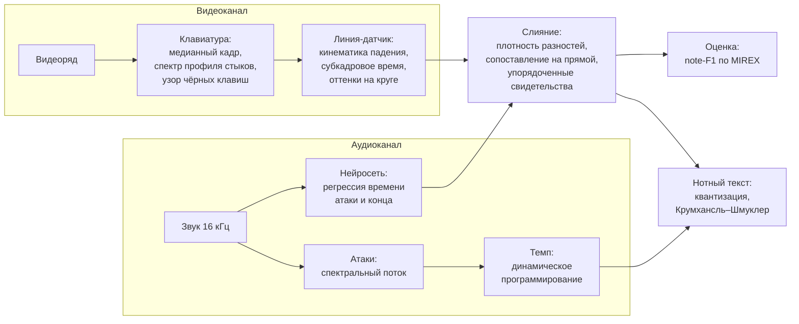

# Теоретические основы

Здесь собрана теория, на которой стоит проект, — по темам, а не по модулям. Страницы модулей отвечают на вопрос «как устроен код и что показали замеры»; этот раздел — на вопрос «какой метод здесь работает и почему он вообще работает». Из него же собираются теоретическая глава и глава проектирования пояснительной записки (#50, #51).

Каждая страница устроена одинаково: модель или метод, формулы, где это в коде, где у метода граница применимости, источники.

## Карта методов

| Задача | Метод | Код |
|---|---|---|
| [Что нарисовано в ролике](visualizer.md) | ролик как нарисованный MIDI, геометрия клавиатуры | [`keyboard_geometry`](../reference/vision/keyboard_geometry.md) |
| [Где клавиатура в кадре](vision.md) | медианный кадр, оператор Собеля | [`keyboard_detector`](../reference/vision/keyboard_detector.md) |
| [Шаг клавиш](vision.md) | спектральная оценка периода с проверкой гармоник | [`keyboard_detector`](../reference/vision/keyboard_detector.md) |
| [Какие это ноты](vision.md) | циклическое сопоставление с шаблоном | [`keyboard_detector`](../reference/vision/keyboard_detector.md) |
| [Ноты по блокам](vision.md) | двухполосный датчик, скорость по задержке | [`line_sensor`](../reference/vision/line_sensor.md) |
| [Партии рук](vision.md) | разбиение оттенков на круге | [`line_sensor`](../reference/vision/line_sensor.md) |
| [Ноты по звуку](audio.md) | CRNN с регрессией времени (Kong et al., 2021) | [`transcriber`](../reference/audio/transcriber.md) |
| [Атаки](audio.md) | спектральный поток в мел-шкале | [`onsets`](../reference/audio/onsets.md) |
| [Темп и доли](audio.md) | динамическое программирование (Ellis, 2007) | [`tempo`](../reference/audio/tempo.md) |
| [Рассинхрон](fusion.md) | ядерная оценка плотности разностей, кривая сдвига | [`aligner`](../reference/fusion/aligner.md) |
| [Пары нот](fusion.md) | оптимальное сопоставление на прямой | [`matcher`](../reference/fusion/matcher.md) |
| [Одиночные ноты](fusion.md) | правила по силе свидетельства | [`resolver`](../reference/fusion/resolver.md) |
| [Качество](metrics.md) | precision / recall / F1 по правилам MIREX | [`metrics`](../reference/eval/metrics.md) |
| [Нотный текст](notation.md) | квантизация, тональность, размер, паузы, станы — *этап 5, ещё не реализовано* | [`notation`](../reference/notation/index.md) |

## Обозначения

Используются на всех страницах раздела.

| | |
|---|---|
| $t$ | время, с |
| $p$ | высота ноты — номер MIDI, 21…108 для рояля |
| $f_s$ | частота кадров видео, кадр/с |
| $v$ | скорость падения блоков, пикс./с |
| $y_c$ | линия касания — высота, на которой блок встречает клавиатуру |
| $\delta$ | рассинхрон: насколько звук позже картинки, с |
| $\tau$ | допуск при сопоставлении нот, с |

## Порядок чтения

1. [Модель ролика](visualizer.md) — без неё непонятно, почему ноты можно снимать над клавиатурой, а не с неё.
2. [Компьютерное зрение](vision.md) и [Анализ звука](audio.md) — два независимых канала.
3. [Слияние каналов](fusion.md) — заявленная новизна работы.
4. [Оценка качества](metrics.md) — как мерить и почему именно так.
5. [Нотный текст](notation.md) — что ещё предстоит, и на какой теории оно будет стоять.

Общий обзор области — автоматической транскрипции музыки — в [обзоре литературы](../literature-review.md).

## Учебники по всей области

- Müller M. Fundamentals of Music Processing: Audio, Analysis, Algorithms, Applications. 2nd ed. Springer, 2021. — STFT, атаки, темп, транскрипция, сопоставление последовательностей.
- Gonzalez R. C., Woods R. E. Digital Image Processing. 4th ed. Pearson, 2018. — медианная фильтрация, градиенты, преобразование Фурье изображений.
- Benetos E., Dixon S., Duan Z., Ewert S. Automatic Music Transcription: An Overview // IEEE Signal Processing Magazine. 2019. Vol. 36, № 1. P. 20–30.
